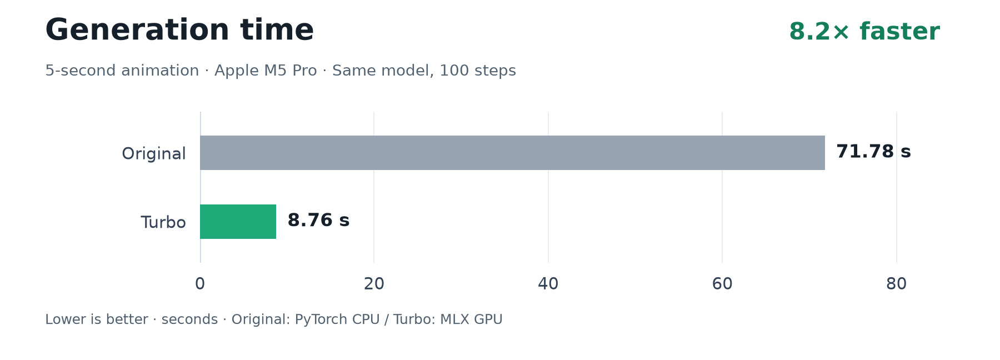
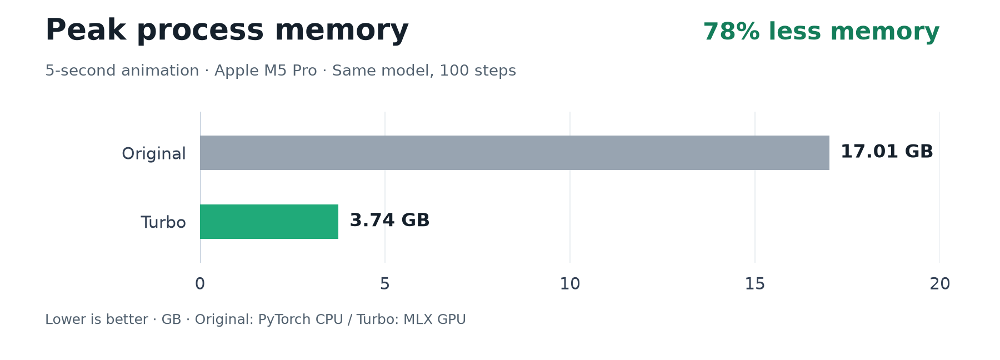
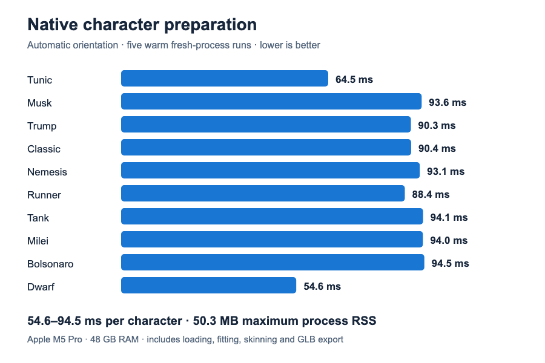
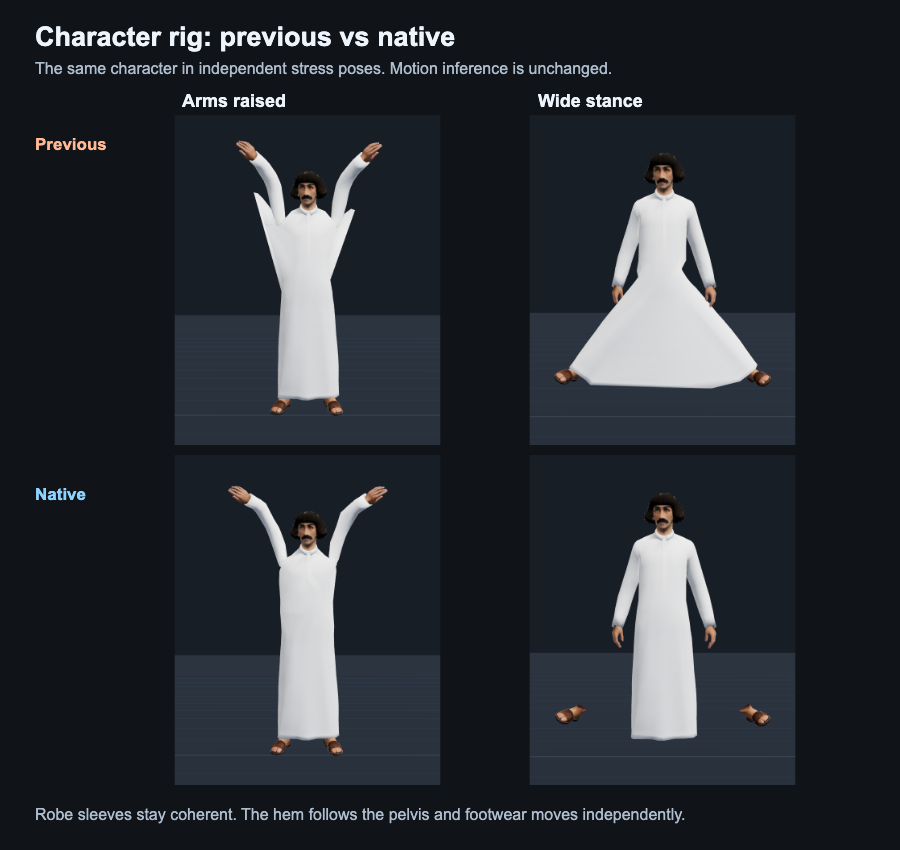

# Kimodo Turbo

**[Download the complete model on Hugging Face](https://huggingface.co/Javascript/Llama-3-Kimodo-Turbo)** · 16.3 GB · Ready for inference

https://github.com/user-attachments/assets/de3eb96a-0d6b-4ab9-9ed0-d9b21fcd15cf

Real-time demo at **1× speed, without cuts**: a 5-second motion generated in **6.9 s**,
with the model already loaded. The large counter measures **~7.0 s from click to playback**.
[Download the video](docs/assets/real-time-demo.mp4).

Generate human motion on Apple Silicon with **8.2× faster generation** and **78% less peak
process memory** than the original Kimodo running on CPU on the same Mac.

Same model. Same 100 diffusion steps. BF16 text encoder and FP32 denoiser.

## Original vs Turbo

A **5-second animation**, end to end, on an **Apple M5 Pro with 48 GB RAM**.
Lower is better in both charts. Turbo's embedding cache is disabled for this comparison.





| | Original Kimodo | Kimodo Turbo |
|---|---:|---:|
| Median generation time | 71.78 s | **8.76 s** |
| Maximum process memory | 17.01 GB | **3.74 GB** |
| With a cached prompt | — | **8.20 s / 2.40 GB** |

Measured in fresh processes with a warm OS disk cache: 2 Original runs and 5 Turbo runs.
Memory is macOS peak process footprint, including GPU allocations, not total system RAM.
The original runs on PyTorch CPU; Turbo runs on MLX GPU. This is not a CUDA GPU comparison.
See [measurement details and precision checks](PERF.md) and [raw results](docs/latency.json).

## Run

Requirements: Apple Silicon, macOS, Python 3.12, `uv`, Rust 1.88+, CMake and a C++ compiler.
Keep the checkout in its installed location.

```sh
./scripts/setup.zsh
.venv/bin/kimodo-turbo ui
```

Open **http://127.0.0.1:8765**. Describe the motion, set its duration, and click **Generate motion**.
The included character plays the result. **Choose character** loads your own GLB and prepares
its skeleton automatically. Scrub, pause, change playback speed, or download the NPZ.
The **Tested characters** dropdown switches between the ten local validation models when
their library is installed under `out/characters/library/`. These private assets stay outside Git.
The UI uses 100 diffusion steps and foot-skate post-processing by default.

Use the CLI for constraints, multiple prompts and export options:

```sh
.venv/bin/kimodo-turbo gen "A person jumps forward and lands softly." \
  --duration 5 --seed 0 --bvh --output out/motions/jump
.venv/bin/kimodo-turbo gen --help
```

`gen` accepts the original `kimodo_gen` options and writes its NPZ/BVH/CSV formats.
Outputs default to `out/motions/`. Default model: `Kimodo-SOMA-RP-v1`.
`KIMODO_TURBO_NO_CACHE=1` disables the exact text-embedding cache.
Use `ui --port 9000` to select another local port.

## Character autorig

The native Rust autorig works independently of motion inference:

```sh
./scripts/build-autorig.zsh
./scripts/autorig.zsh character.glb out/characters/character-rigged.glb \
  --report out/characters/character-rigged.json
```

Use a standing humanoid in a neutral, A or T pose, with embedded geometry and textures.
The tool fits 27 body joints, finds surface distances and solves smooth skin weights with
preconditioned conjugate gradients. Body-volume priors keep the waist out of the arm weights.
For a continuous lower garment, it separates clothing and footwear attachment seams while
preserving rest triangle positions, UVs, normals and texture payloads.

Existing authored skins are preserved; `--force` rebuilds them. `--up` and `--forward` override
automatic orientation. Identical input and options produce identical GLB bytes with the same
build. The UI caches prepared characters by source and executable hashes.

Validated on **10 local characters** across six stress poses: rest recovery, skin weights,
triangle geometry and repeatable output pass in all ten. Native preparation takes
**54.6–94.5 ms** per character, with **50.3 MB** maximum process RSS on this Mac.





Long garments follow the pelvis. This is body skinning, with no fabric dynamics or collision
simulation; extreme leg poses can expose ankle ends or intersect fabric. Hidden joints are
fitted from proportions, and missing leg geometry is not reconstructed.
See [validation and measurements](PERF.md#character-autorig).

## Weights and setup

The complete **16.3 GB** inference model is on
[Hugging Face: Llama 3 Kimodo Turbo](https://huggingface.co/Javascript/Llama-3-Kimodo-Turbo),
with the same comparison images and all component licenses.

Setup pins and patches upstream Kimodo, installs dependencies in `.venv/`, and downloads a
pinned model revision into `out/weights/`. It includes the motion checkpoint, normalization
statistics, tokenizer and streamed encoder shards. **No local weight conversion is required.**
Downloads resume on repeated runs. Weights, caches and generated motions are excluded from Git.

Built with Meta Llama 3. Upstream Kimodo code uses Apache-2.0; weights retain the NVIDIA Open
Model License, Meta Llama 3 Community License and McGill LLM2Vec MIT terms.
The model repository includes [licenses and attribution](https://huggingface.co/Javascript/Llama-3-Kimodo-Turbo/blob/main/LICENSE).

## Code

```text
kimodo_turbo/    CLI, streamed encoder, MLX denoiser, upstream adapter, local UI server
native/         Deterministic humanoid fitting, skin weights and GLB export
ui/             Simple motion preview, bundled character and local Three.js modules
scripts/        Setup, native autorig entry points and independent validation
tests/          Analytical skinning and transformation checks
patches/        Apple Silicon build support and lazy encoder import
docs/           Recorded benchmark evidence and comparison charts
out/            Local inference weights, caches and generated motions (ignored)
```

Turbo streams encoder layers, compiles the FP32 denoising step, reuses constant tokens and skips
identical CFG rows. Upstream Kimodo still handles constraints, stitching, kinematics,
post-processing and export. Numerical agreement was checked on eight held-out prompts;
see [PERF.md](PERF.md).
